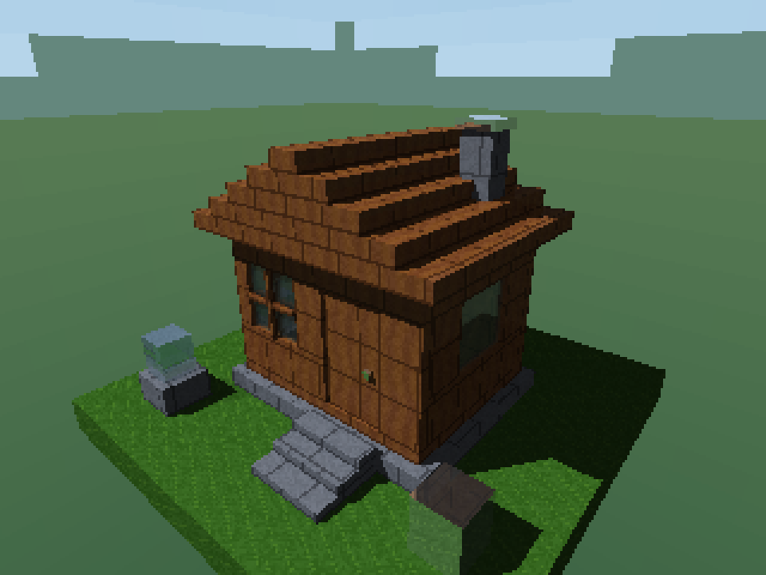
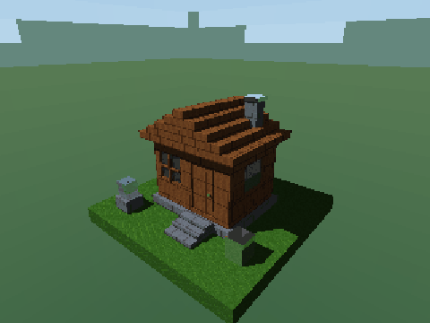

# Proyecto 2 — Ray tracing

Una cabaña de cubos texturizados, con ventanas de vidrio, techo escalonado, chimenea y escalones de piedra. El render se calcula en CPU con Zig; la API de Windows se usa para mostrar los píxeles y leer el teclado.



## Video

[Ver la presentación del proyecto en YouTube](https://youtu.be/JT8QKsqJnRE)

### Recorrido del diorama

[Ver o descargar el video del diorama — MP4, 32 segundos](https://github.com/Guallitoprogra/Proyecto-2-Graficas-/raw/refs/heads/main/media/diorama.mp4)

El recorrido muestra rotación, zoom, cambios de altura y una comparación entre uno y ocho hilos. Se generó con el mismo renderizador del programa; los tiempos mostrados corresponden a cada cuadro exportado. El video no tiene audio.

<details>
<summary>Ver una vista previa animada</summary>



</details>

## Ejecutar

Se necesita **Windows y Zig 0.16.0**. No hace falta instalar librerías de terceros.

```powershell
git clone https://github.com/Guallitoprogra/Proyecto-2-Graficas-.git
cd Proyecto-2-Graficas-
zig build run -Doptimize=ReleaseFast
```

Si ya tienes la carpeta, ejecuta solamente el último comando dentro de ella. El ejecutable también queda en `zig-out/bin/diorama.exe`.

## Controles

| Tecla | Acción |
|---|---|
| `A` / `D` | Girar alrededor de la cabaña |
| `W` / `S` | Subir o bajar la cámara |
| `Q` / `E` | Acercar o alejar |
| `R` | Restablecer la vista |
| `1` | Renderizar con un hilo |
| `2` | Renderizar con varios hilos, hasta ocho |
| `Esc` | Cerrar |

El título de la ventana muestra los hilos utilizados y los milisegundos del último render. La imagen se recalcula cuando cambia la vista o el número de hilos.

## Materiales y efectos

| Material | Dónde se usa |
|---|---|
| Terreno | Base del diorama |
| Madera | Paredes, puerta y techo |
| Piedra | Cimientos, escalones y chimenea |
| Vidrio | Ventanas y bloque sobre el pedestal |
| Metal | Bloque reflectante, manija y tapa de la chimenea |

Cada material tiene una textura propia de 32 × 32 píxeles y parámetros de albedo, especular, transparencia y reflectividad. Las texturas PPM están incluidas en el ejecutable.

Hay iluminación ambiente, difusa y especular, sombras, reflexión, refracción en el vidrio y un skybox de seis caras. Los rayos secundarios tienen un límite de seis rebotes. El render usa 320 × 240 píxeles y se escala conservando la proporción 4:3.

## Comprobaciones

```powershell
zig build test
zig build benchmark -Doptimize=ReleaseFast
```

Las doce pruebas cubren intersecciones, cámara, texturas, skybox, sombras, reflexión, refracción y la igualdad de la imagen entre el render secuencial y el concurrente.

El benchmark compara doce vistas y verifica los píxeles de cada una. En esta computadora, a 320 × 240, el promedio fue **46,16 ms con un hilo** y **9,74 ms con ocho hilos**: una mejora de **4,74 veces**. Los resultados cambian según el equipo y los procesos que estén abiertos.

Para volver a exportar los cuadros del recorrido:

```powershell
zig build demo -Doptimize=ReleaseFast
```

Esto crea `.zig-cache/demo.bgra` y `.zig-cache/demo-times.txt`: 480 cuadros BGRA de 320 × 240 para reproducir a 15 fps, junto con sus tiempos. Son archivos temporales; el MP4 listo para ver está en `media/diorama.mp4`.
